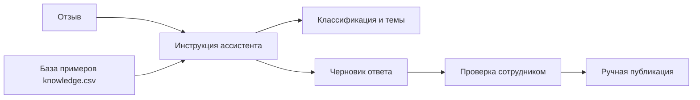

# Как работает ассистент

Ассистент не публикует ответы самостоятельно.

## Пример
Отзыв: «Кружка красивая, но пришла со сколом».

Ожидаемая логика: смешанный отзыв, тема качества, признание проблемы, предложение разрешённого канала поддержки без обещания возврата.

[Демонстрационная аналитика](analytics-example.md) и [фактическая сводка CSV с ограничениями проверки](actual-test-response-2026-11-13.md).
