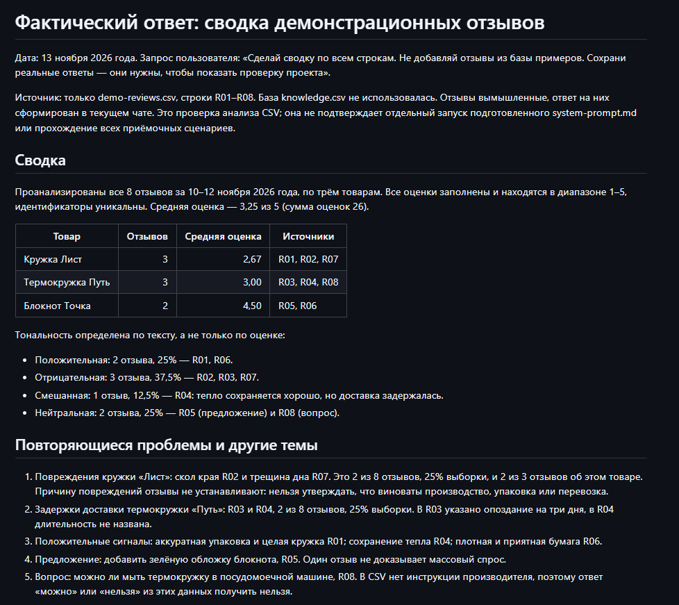

# Ассистент для работы с отзывами клиентов

Учебный проект по PEcf06.2. Ассистент помогает сотруднику разобрать отзыв, подготовить корректный ответ и увидеть повторяющиеся проблемы. Он работает в ChatGPT: пользователь загружает базу знаний, вставляет инструкцию и передаёт отзывы. Автоматической публикации и подключения к площадкам нет.

## Состав проекта

- `system-prompt.md` — готовая инструкция для ассистента.
- `knowledge.csv` — база типовых ситуаций, правил и примеров ответов.
- `demo-reviews.csv` — вымышленные отзывы для пакетного анализа.
- `scenarios-and-guide.md` — сценарии, запуск и обновление.
- `analytics-example.md` — проверяемый пример сводки по демонстрационному набору.
- `acceptance-checks.md` — проверочные запросы и ожидаемое поведение.

## Что можно проверить

1. Жалобы, благодарности, предложения и вопросы обрабатываются по-разному.
2. Тональность и темы определяются отдельно: один отзыв может содержать несколько тем.
3. Если неизвестны условия возврата, ассистент не обещает деньги или срок решения.
4. Личные данные не попадают в публичный ответ.
5. Сводка показывает число отзывов, доли тональностей, оценки и повторяющиеся темы с идентификаторами источников.

Все названия товаров, отзывы и правила магазина в этом проекте вымышленные. Это демонстрация логики работы, а не внедрение для реального клиента. Экономия времени и коммерческий эффект не измерялись. Проверочные сценарии описывают критерии приёмки; они не являются журналом независимого тестирования через API.

## Запуск

Откройте новый чат в ChatGPT, загрузите `knowledge.csv`, затем вставьте содержимое `system-prompt.md` первым сообщением и напишите: «Используй эту инструкцию для последующих отзывов». Для повторного использования можно поместить текст в инструкции собственного ассистента, если этот режим доступен в вашем аккаунте. В обычном чате это пользовательская инструкция, а не настоящий системный уровень API.

Проверка одного отзыва: «Разбери отзыв: кружка красивая, но пришла со сколом. Оценка 2, товар Кружка Лист, id T01». Для сводки загрузите `demo-reviews.csv` и напишите: «Сделай сводку по всем строкам. Не добавляй отзывы из базы примеров».

## Скриншот

Сохранённая сводка демонстрационных отзывов; не полный прогон системной инструкции.

[Схема и примеры](EXAMPLES.md).
